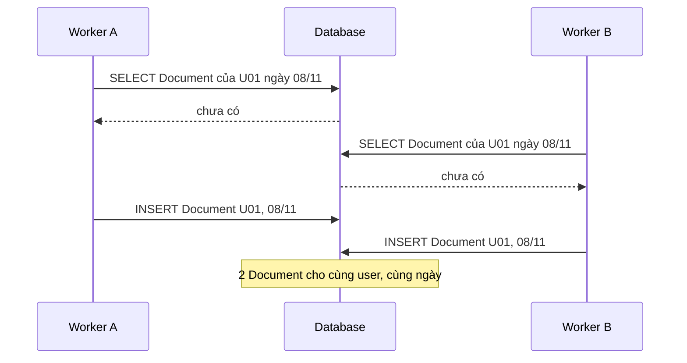
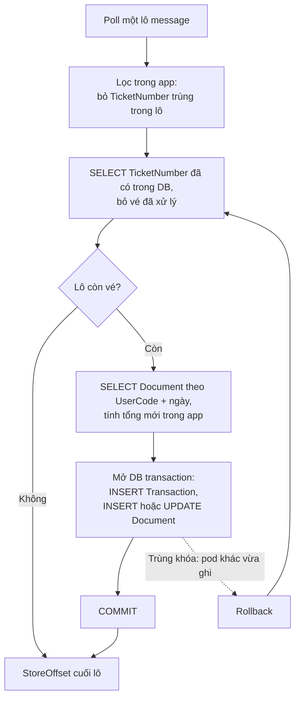

# Worker Kafka scale lên 2 pod thì tạo trùng Document: thiết kế lại phía consumer

*Trả lời câu hỏi của bạn đọc, 2026-11-08. Bối cảnh: worker .NET dùng EF Core, đọc message vé từ topic Kafka của hệ thống khác, chạy trên Kubernetes có autoscale.*

Worker chạy 1 instance thì đúng, scale lên 2 instance thì sai: lần đầu cho worker chạy song song, gần như ai cũng gặp lỗi này. Tin tốt là cách sửa căn cơ nằm ở database, không cần tới Redis lock.

---

## 1. Bài toán

- **Message:** Mỗi message là một vé, gồm `TicketNumber`, `UserCode`, `DateOfIssue`, `Amount`. Producer thuộc hệ thống khác, phía bạn không sửa được.
- **Bảng `Document`:** Mỗi `UserCode` trong mỗi ngày `DateOfIssue` có đúng một Document. Cột `TotalAmount` lưu tổng tiền mọi vé của user đó trong ngày.
- **Bảng `Transaction`:** Mỗi vé một dòng.
- **Code hiện tại:** Tìm Document theo (`UserCode`, `DateOfIssue`). Chưa có thì tạo Document mới, có rồi thì cộng `Amount` vào `TotalAmount`, sau đó tạo Transaction.
- **Sự cố:** Chạy 1 pod thì dữ liệu đúng. Kubernetes tự scale lên 2 pod thì cùng một user trong cùng một ngày có 2 Document, và `TotalAmount` không khớp với tổng tiền của các Transaction.

---

## 2. Root cause: các nguyên nhân lộ ra khi chạy 2 pod

### 2.1 Check-then-act: hai worker cùng thấy "chưa có Document"

Thao tác "tìm, chưa có thì tạo" gồm hai câu lệnh rời: một câu `SELECT` và một câu `INSERT`. Giữa hai câu có một khoảng hở, và worker thứ hai chen vào đúng khoảng đó:

Cả hai worker quyết định dựa trên kết quả "chưa có", nhưng kết quả đó đã cũ ngay lúc worker kịp `INSERT`. Dạng lỗi này có tên check-then-act, phân tích kỹ ở bài [Race condition: vì sao count++ sai khi hai thread cùng chạy](https://zemit.substack.com/p/race-condition-vi-sao-count-sai-khi), mục 2.2 (bài này đọc miễn phí).

Bọc hai câu trong một DB transaction cũng không chặn được lỗi này:

- **READ COMMITTED (mức mặc định):** Câu `SELECT` không khóa được một dòng chưa tồn tại, nên hai transaction vẫn cùng thấy "chưa có" và cùng `INSERT`.
- **SERIALIZABLE:** Database chặn được trùng, nhưng hai transaction chặn nhau và database hủy một bên (deadlock trên SQL Server và MySQL, lỗi serialization trên PostgreSQL). Code vẫn phải bắt lỗi rồi làm lại, trong khi mọi câu đọc đều tốn thêm chi phí khóa. Cơ chế khóa khoảng trống khi `INSERT` nằm ở bài *Vì sao bạn deadlock dù chắc chắn chỉ đụng 1 bản ghi* (sắp lên).

### 2.2 TotalAmount sai: bốn đường làm lệch tổng tiền

- **Document bị tách đôi:** Vé của U01 ngày 08/11 chia vào 2 Document, nên mỗi Document chỉ giữ một phần tổng tiền.
- **Lost update:** Code đọc `TotalAmount` lên, cộng trong bộ nhớ rồi ghi lại tổng mới. Hai pod cùng đọc được 100: pod A cộng 50 và ghi 150, pod B cộng 70 và ghi 170. Kết quả là 170 thay vì 220, vì lần ghi của B đè mất khoản 50 của A (bài Race condition, mục 7).
- **Message bị xử lý lại:** Kafka giao message theo kiểu at-least-once (ít nhất một lần). Worker ghi DB xong nhưng chưa kịp commit offset thì pod bị tắt (scale down, redeploy), hoặc partition bị chuyển sang pod khác lúc rebalance (Kafka chia lại partition giữa các consumer mỗi khi có pod vào hoặc ra group). Pod nhận partition đọc lại từ offset đã commit gần nhất, nên các vé đó được ghi thêm một Transaction và cộng tiền lần hai.
- **Producer gửi trùng:** Phía producer cũng chạy theo at-least-once (không chắc message đã tới broker thì gửi lại), nên topic có thể chứa hai message của cùng một vé ở hai offset khác nhau. Consumer commit offset đúng tới đâu cũng vẫn đọc và xử lý cả hai message đó. Ba tình huống hay gặp:
  - **Retry khi mất phản hồi:** Broker đã ghi message nhưng phản hồi mất trên đường về, producer gửi lại và broker ghi thêm bản thứ hai. Idempotent producer chặn được tình huống này, nhưng client Java chỉ bật mặc định từ Kafka 3.0, còn client dựa trên librdkafka (.NET, Go, Python) mặc định vẫn tắt.
  - **Producer khởi động lại:** Idempotence chỉ chống trùng trong một phiên chạy của producer. Ứng dụng phía producer restart rồi gửi lại những message chưa nhận được xác nhận thì broker coi đó là message mới.
  - **Code phía producer tự gửi lại:** Hệ thống kia tự retry khi lệnh gửi báo timeout, hoặc chạy lại một job đồng bộ dữ liệu, thì mỗi lần chạy sinh thêm một message với cùng `TicketNumber`.

Kafka chỉ cam kết at-least-once ở cả hai đầu, nên phần chống trùng thuộc về consumer. Bài [Kafka producer: send() không gửi ngay](https://zemitprivate.substack.com/p/kafka-producer-send-khong-gui-ngay), mục 6, giải thích vì sao producer retry tạo ra bản trùng. Bài [Kafka idempotent producer: ordering, duplicate và sequence number](https://zemitprivate.substack.com/p/kafka-idempotent-producer-ordering), mục 5, liệt kê sáu chỗ idempotent producer không chặn được trùng.

### 2.3 Group ID: kiểm tra trước khi sửa code

Câu "Kafka đẩy message cho cả 2 worker" có hai cách hiểu, ứng với hai lỗi khác nhau:

- **Hai pod chung `GroupId`:** Kafka chia partition cho hai pod, mỗi message chỉ tới một pod. Lỗi trùng đến từ check-then-act khi hai vé cùng user cùng ngày nằm ở hai partition khác nhau.
- **Hai pod khác `GroupId`:** Mỗi pod là một consumer group riêng và đọc toàn bộ topic, nên mọi vé bị xử lý hai lần. Lỗi này hay gặp khi `GroupId` được ghép từ tên máy, tên pod (`Environment.MachineName`) hoặc một `Guid` sinh lúc khởi động.

**Dấu hiệu:** Topic chỉ có 1 partition mà cả hai pod đều xử lý message, hoặc vé nào cũng có 2 Transaction, thì nhiều khả năng hai pod đang khác `GroupId`. Cách sửa là đặt `GroupId` cố định trong config.

---

## 3. Thiết kế: ba lớp bảo vệ

**Nguyên lý nền:** Partition theo `UserCode` giảm số lần hai pod đụng nhau, còn database mới là nơi đảm bảo kết quả đúng. Partition có lúc hở (rebalance, xử lý lại), khi đó unique key ở database bắt được phần chạy chồng và buộc pod ghi sau làm lại.

- **Lớp 1, partition theo `UserCode`:** Mọi vé của một user vào cùng một partition, do một pod xử lý tuần tự.
- **Lớp 2, khóa duy nhất cho (`UserCode`, `DateOfIssue`):** Database từ chối Document thứ hai cho cùng user cùng ngày.
- **Lớp 3, chống trùng vé:** Code bỏ vé trùng và vé đã xử lý trước khi tính `TotalAmount`, database giữ unique `TicketNumber` làm lưới an toàn, nên một vé tới hai lần không làm lệch tổng tiền.

### 3.1 Lớp 1: partition theo UserCode

Producer chọn partition theo key của message: cùng key thì cùng partition, miễn là số partition của topic không đổi. Trong một consumer group, mỗi partition tại một thời điểm chỉ được giao cho một consumer (một consumer có thể giữ nhiều partition). Vì vậy khi key là `UserCode`, mọi vé của U01 nằm trong một partition và chỉ một pod đọc các vé đó theo thứ tự, nên lúc chạy bình thường hai pod không còn tranh nhau cùng một Document.

Cơ chế chọn partition theo key nằm ở bài [Kafka producer: send() không gửi ngay](https://zemitprivate.substack.com/p/kafka-producer-send-khong-gui-ngay), mục 7.1. Cách nhìn partition như "mỗi key một làn xử lý riêng, một người ghi duy nhất" nằm ở bài *Keyed executor và single-writer* (sắp lên).

Producer không sửa được, nên việc đầu tiên là xem message hiện đang mang key gì:

- **Key đã là `UserCode` (hoặc `UserCode` ghép `DateOfIssue`):** Partition theo `UserCode` đã có sẵn, không phải làm gì thêm.
- **Key khác hoặc null:** Có hai đường. Đường thứ nhất là nhờ team producer đổi key; payload giữ nguyên, nhưng team đó cần xác nhận không consumer nào khác của topic dựa vào key cũ. Đường thứ hai là phía bạn thêm một bước re-key: một worker nhỏ đọc topic gốc rồi ghi sang topic nội bộ với key là `UserCode`, worker chính đọc topic nội bộ này. Bước re-key tốn thêm một topic và vài mili giây trễ.
- **Không làm được cả hai đường:** Bỏ bước partition theo `UserCode`. Dữ liệu vẫn đúng nhờ unique key cho Document (lớp 2), chống trùng vé (lớp 3) và câu `UPDATE` kèm điều kiện tổng tiền đã đọc (0 dòng bị ảnh hưởng thì làm lại), chỉ là hai pod đụng nhau thường xuyên hơn và code phải làm lại nhiều lần hơn.

Partition theo key vẫn để lại hai khoảng hở, nên partition theo `UserCode` không đứng một mình được:

- **Xử lý lại sau rebalance hoặc restart:** Đúng đường "message bị xử lý lại" ở phần nguyên nhân phía trên.
- **Worker xử lý quá chậm:** Một lô chạy lâu hơn `max.poll.interval.ms` (mặc định 5 phút) thì worker bị đưa ra khỏi group và partition được giao cho pod khác, trong khi worker cũ vẫn đang ghi DB dở. Trong một khoảng ngắn, hai pod cùng ghi dữ liệu của một partition (bài [Kafka consumer: mọi config quan trọng đều xoay quanh poll()](https://zemitprivate.substack.com/p/kafka-consumer-moi-config-quan-trong), mục 4).

Cấu hình đi kèm khi chạy trên Kubernetes:

- **Số pod tối đa:** Không vượt số partition của topic, vì pod dư không nhận partition nào (bài Kafka consumer, sai lầm 8).
- **Điều kiện autoscale:** Scale theo consumer lag (ví dụ KEDA Kafka scaler) thay vì CPU, và giãn khoảng cách giữa hai lần scale, vì mỗi lần thêm hay bớt pod là một lần rebalance (bài Kafka consumer, mục 10.4).
- **Store offset sau khi commit DB:** Confluent.Kafka (dựa trên librdkafka) auto commit bằng thread nền mỗi 5 giây, và mặc định đánh dấu offset ngay khi trả message cho code. Pod chết đúng lúc thì offset đã commit trong khi vé chưa xuống DB, nghĩa là mất vé. Đặt `EnableAutoOffsetStore = false` và chỉ gọi `StoreOffset()` sau khi transaction DB commit thành công (bài Kafka consumer, mục 11, có dòng riêng cho client .NET).

### 3.2 Lớp 2: khóa duy nhất cho (UserCode, DateOfIssue)

Ba cách dưới đây khác nhau ở chỗ khóa nằm ở đâu: trên Redis, trên chính bảng `Document`, hay trên một bảng riêng.

#### Cách 1: Redis lock

Mỗi message lấy lock `doc:{UserCode}:{DateOfIssue}` trên Redis (`SET ... NX PX`), giữ lock trong lúc tìm hoặc tạo Document, và nhả lock sau khi transaction DB commit.

- **Mặt lợi:** Không đụng schema, không cần quan tâm dữ liệu cũ đang trùng.
- **Mặt hại 1:** Thêm một hạ tầng phải vận hành và theo dõi. Redis chậm hoặc failover thì worker đứng theo.
- **Mặt hại 2:** TTL kẹt hai đầu. Pod bị kill lúc redeploy mà chưa nhả lock thì lock còn tới hết TTL, pod mới phải chờ. TTL ngắn mà DB chậm hoặc pod bị treo vài giây thì lock hết hạn khi worker cũ vẫn đang ghi, và hai worker lại cùng ghi.
- **Mặt hại 3:** Xử lý theo lô rất khó. Một lô 500 message có thể chứa vài trăm cặp (`UserCode`, `DateOfIssue`), tức vài trăm lock. Lúc rebalance, hai pod lấy lock theo thứ tự khác nhau thì mỗi bên giữ một phần và chờ nhau (deadlock), nên phải gom việc lấy lock vào một Lua script: lấy được hết hoặc không lấy gì.
- **Mặt hại 4:** Lock không chặn được message bị xử lý lại hay message producer gửi trùng, nên vẫn phải có bước chống trùng vé (lớp 3).

Redis lock, TTL, watchdog, và lý do không nên đưa lock ra Redis cho việc gọn trong một transaction: bài [Bốn cách triển khai pessimistic lock](https://zemitprivate.substack.com/p/bon-cach-trien-khai-pessimistic-lock), mục 2.4 và 3.4. Lua script cho lock: bài *Lua script trong Redis* (sắp lên). Lock hết hạn giữa chừng và fencing token: bài *Từ lock trong JVM tới distributed lock* (sắp lên).

#### Cách 2: unique index trên Document(UserCode, DateOfIssue)

Database chặn trùng thay cho code. Worker thứ hai `INSERT` cùng cặp thì database bắt transaction đó chờ transaction của worker thứ nhất commit, rồi trả lỗi trùng khóa. Worker thứ hai rollback và làm lại message; lần làm lại thấy Document đã có nên đi nhánh `UPDATE`.

- **Mặt lợi:** Không thêm hạ tầng. Dữ liệu đúng cả khi hai pod chạy chồng lúc rebalance lẫn khi một vé bị xử lý lại. Ghi theo lô được, vì một lô chỉ cần gộp theo cặp (`UserCode`, `DateOfIssue`) rồi ghi. Khi message đã có partition key là `UserCode` (lớp 1), mọi vé của một user do một pod xử lý tuần tự, nên hai pod chỉ còn tranh nhau cùng một Document trong khoảng chồng lúc rebalance, và database gần như không phải bắt worker nào chờ hay làm lại.
- **Mặt hại:** Phải dọn hết Document trùng trước, vì database từ chối tạo unique index trên dữ liệu đang trùng. Bảng lớn thì tạo index phải chạy online để không khóa bảng (SQL Server: `WITH (ONLINE = ON)`, cần bản Enterprise hoặc Azure SQL; PostgreSQL: `CREATE UNIQUE INDEX CONCURRENTLY`; MySQL: `ALGORITHM=INPLACE, LOCK=NONE`). Chi tiết ở bài *Tạo index mà không sập hệ thống: online DDL* (sắp lên).
- **Kiểu dữ liệu của cột ngày:** Index phải đặt trên giá trị ngày (kiểu `date`), chốt theo một múi giờ thống nhất. Đặt trên cột `datetime` thì 08:00 và 09:00 của cùng một ngày là hai giá trị khác nhau, và index không chặn được gì.
- **Biến thể, unique index có điều kiện:** SQL Server (filtered index) và PostgreSQL (partial index) cho phép unique index chỉ áp lên dòng mới, ví dụ điều kiện `Id` lớn hơn Id lớn nhất lúc tạo index. Dòng cũ đang trùng không cản việc tạo index, nên chặn được trùng mới ngay rồi dọn dữ liệu cũ sau. MySQL không có loại index này.

#### Cách 3: bảng khóa riêng

Bảng `DocumentKey` gồm (`UserCode`, `DateOfIssue`), unique trên hai cột này. Trong cùng DB transaction tạo Document, worker `INSERT` vào `DocumentKey` trước; trùng khóa thì rollback và làm lại, giống cách 2.

- **Mặt lợi:** Chặn trùng như cách 2 mà không phải dọn bảng `Document` trước.
- **Mặt hại:** Thêm một bảng, và mọi đường tạo Document (worker, API, tool nhập tay nếu có) phải ghi qua bảng này; sót một đường là hở.
- **Nạp sẵn dữ liệu cũ:** Nạp `DocumentKey` từ Document hiện có, mỗi cặp một dòng (`GROUP BY`, nên trùng ở bảng chính không cản). Không nạp thì một vé đến muộn cho ngày cũ vẫn `INSERT` được vào `DocumentKey` (bảng chưa có cặp đó) và tạo thêm một Document cho ngày đã có Document.
- **Thêm cột `DocumentId`:** Nạp bằng Id nhỏ nhất của mỗi cặp. Với ngày cũ đang có 2 Document, worker đọc và ghi tổng tiền đúng vào một Document theo `DocumentId`, thay vì câu `UPDATE ... WHERE UserCode = ... AND DateOfIssue = ...` ghi vào cả hai.

### 3.3 Lớp 3: chống trùng vé trong code, unique TicketNumber làm lưới an toàn

Unique key cho (`UserCode`, `DateOfIssue`) chỉ chặn Document trùng. Để `TotalAmount` đúng kể cả khi một vé tới consumer hai lần (consumer đọc lại hoặc producer gửi trùng), code xử lý trùng trước khi ghi, rồi ghi thẳng giá trị bằng câu `INSERT` hoặc `UPDATE` thông thường:

- **Lọc trùng trong code:** Code bỏ vé trùng trong lô và vé đã có trong bảng Transaction, rồi mới tính `TotalAmount` mới từ những vé còn lại. Câu `UPDATE` ghi thẳng tổng đã tính, database không phải cộng gì.
- **Unique trên `Transaction(TicketNumber)` làm lưới an toàn:** `TicketNumber` có sẵn trong payload và định danh duy nhất một vé, nên dùng được làm idempotency key (khóa nhận diện "vé này đã xử lý rồi") mà không cần producer gửi thêm gì. Hai pod chạy chồng cùng ghi một vé mà bước lọc chưa kịp thấy thì database báo trùng khóa, và pod ghi sau rollback cả lô, kể cả câu `UPDATE` tổng tiền.

**Vì sao ghi thẳng tổng tiền vẫn đúng:** Hai pod cùng tính tổng cho một Document từ hai nhóm vé khác nhau thì lần ghi sau đè mất lần ghi trước, đúng lỗi lost update ở phần nguyên nhân. Partition key là `UserCode` loại bỏ trường hợp này, vì vé của một user chỉ nằm trong một partition: hai pod chỉ chạy chồng trên cùng một dãy vé liên tiếp lúc rebalance, nên phần chạy chồng luôn có vé chung để unique `TicketNumber` bắt.

**Khi message chưa có partition key `UserCode`:** Hai pod có thể cùng tính tổng cho một Document từ hai nhóm vé không chung vé nào, và unique `TicketNumber` không bắt được. Khi đó câu `UPDATE` thêm điều kiện tổng tiền đã đọc (`WHERE Id = @id AND TotalAmount = <tổng đã đọc>`): 0 dòng bị ảnh hưởng nghĩa là pod khác vừa ghi, nên rollback và làm lại cả lô. Cách kiểm tra giá trị cũ ngay trong câu ghi này là optimistic lock, xem bài [Optimistic vs pessimistic lock](https://zemitprivate.substack.com/p/optimistic-vs-pessimistic-lock-vi), mục 2.1.

Hai điểm cần xác nhận với phần `TicketNumber`:

- **Số message của một vé:** Cần hỏi lại nghiệp vụ. Vé có đổi, hoàn, hủy, mỗi lần sinh một message, thì khóa là (`TicketNumber`, loại nghiệp vụ) thay vì riêng `TicketNumber`.
- **Bảng Transaction cũng có thể đang trùng:** Áp đúng lựa chọn đã chọn cho Document: dọn trùng rồi tạo unique, dùng bảng khóa riêng, hoặc dùng unique index có điều kiện.

---

## 4. Processing flow: luồng xử lý một lô message

Mọi bước lọc và tính toán chạy trong app trước, DB transaction chỉ mở ở bước ghi cuối cùng, nên transaction ngắn và không giữ khóa trong lúc code đang đọc hay tính. Worker đang xử lý từng message thì coi mỗi message là một lô một vé, các bước giữ nguyên.

1. **Lọc trong app:** Bỏ bản trùng `TicketNumber` ngay trong lô (producer gửi trùng thì topic có hai bản của cùng một vé), cùng những message không hợp lệ theo luật nghiệp vụ.
2. **Bỏ vé đã xử lý:** Một câu `SELECT` lấy các `TicketNumber` của lô đã có trong bảng Transaction (`WHERE TicketNumber IN (...)`), rồi bỏ khỏi lô; consumer đọc lại sau rebalance hay restart rơi vào nhánh này. Lô không còn vé nào thì store offset rồi chuyển sang lô sau.
3. **Tính tổng trong app:** Gộp vé còn lại theo (`UserCode`, `DateOfIssue`), `SELECT` các Document hiện có của những cặp này, rồi tính tổng mới bằng `TotalAmount` hiện tại cộng tổng `Amount` của vé mới. Cặp chưa có Document thì tổng mới là tổng `Amount` của vé mới. Bước này chạy sau bước bỏ vé đã xử lý, để tổng đọc lên đã gồm mọi vé được ghi trước đó.
4. **Ghi trong một DB transaction ngắn:** Mở transaction, `INSERT` các Transaction, `INSERT` Document cho cặp chưa có (cách 3 thì `INSERT DocumentKey` ngay trước), `UPDATE` `TotalAmount` bằng tổng vừa tính cho cặp đã có, rồi commit. Commit xong mới store offset cuối lô của từng partition.

Đụng lỗi trùng khóa (hoặc câu `UPDATE` có điều kiện trả 0 dòng) nghĩa là pod khác vừa ghi một phần của lô: rollback rồi làm lại từ bước bỏ vé đã xử lý, và lần làm lại tự bỏ phần pod kia đã ghi. Lỗi khác như DB mất kết nối hay timeout thì không store offset, để lô được đọc lại sau một khoảng chờ thay vì bị bỏ qua (bài [Kafka consumer best practice: lấy batching làm trung tâm](https://zemitprivate.substack.com/p/kafka-consumer-best-practice-lay), mục 4 và 5.2).

---

## 5. Data cleanup: dọn dữ liệu cũ

Document trùng và `TotalAmount` lệch đang nằm trong DB nghĩa là báo cáo đang sai, nên chọn cách nào thì vẫn phải dọn. Thứ tự:

1. **Deploy code mới:** Code đã lọc vé trùng trước khi tính tổng và bắt lỗi trùng khóa khi ghi. Nếu đi thẳng cách 2, tạm tắt autoscale và giữ 1 pod trong lúc dọn để không phát sinh trùng mới.
2. **Dọn Transaction trùng:** Mỗi `TicketNumber` giữ một dòng, xóa các dòng còn lại.
3. **Gộp Document trùng:** Mỗi cặp giữ Document có Id nhỏ nhất, chuyển Transaction của các Document còn lại sang Document này, rồi xóa các Document còn lại.
4. **Tính lại tổng tiền:** `TotalAmount` bằng tổng `Amount` của các Transaction thuộc Document đó.
5. **Tạo unique index:** Tạo trên cả Document và Transaction. Database tạo index thành công cũng là bằng chứng dữ liệu đã hết trùng.
6. **Bật lại autoscale.**

Ba lưu ý khi dọn:

- **Chia nhỏ từng đợt:** Mỗi transaction xử lý vài nghìn cặp, không gom cả bảng vào một transaction, vì transaction dài giữ lock lâu và worker phải đứng chờ suốt thời gian đó. Bài *Long transaction giết service thế nào* (sắp lên) phân tích kỹ hậu quả này.
- **Document đã đi ra ngoài:** Document đã gửi sang kế toán, đã in hóa đơn, hoặc đang được hệ thống khác giữ Id thì cần nghiệp vụ duyệt trước khi xóa. Trường hợp này dùng cách 3 hoặc unique index có điều kiện để chặn trùng mới ngay, dọn sau.
- **Đối soát định kỳ:** Sau khi dọn, giữ một câu query chạy định kỳ liệt kê Document có `TotalAmount` khác tổng `Amount` của các Transaction. Kết quả phải luôn rỗng; có dòng nào là còn một đường ghi nào đó đang sai.

---

## 6. Khuyến nghị

- **Khóa cho Document, chọn cách 2 (unique index) làm đích cuối:** Không thêm hạ tầng, dữ liệu đúng cả khi xử lý lại, ghi theo lô được. Điểm trừ "phải dọn trùng" không phải chi phí riêng của cách 2, vì dữ liệu trùng đằng nào cũng phải dọn.
- **Cách 3 làm bước đệm:** Khi chưa dọn ngay được (chờ nghiệp vụ duyệt, bảng quá lớn), triển khai cách 3 hoặc unique index có điều kiện để chặn trùng từ hôm nay, dọn dần, rồi chuyển sang cách 2.
- **Redis lock không cần cho bài toán này:** Dữ liệu cần bảo vệ nằm trong một database, database có sẵn unique constraint, và lock không chặn được message xử lý lại hay bản trùng từ producer. Redis lock hợp khi thứ cần khóa nằm ngoài database hoặc trải trên nhiều service. Thứ tự cân nhắc "unique constraint, idempotency key, partition theo key trước, distributed lock sau" nằm ở bài *Từ lock trong JVM tới distributed lock* (sắp lên).
- **Chống trùng vé bắt buộc:** Lọc vé trùng trong code cùng unique `TicketNumber` giữ `TotalAmount` đúng khi một vé tới hai lần, dù do consumer đọc lại hay producer gửi trùng.
- **Partition theo `UserCode` làm khi key cho phép:** Có partition key là `UserCode` thì câu `UPDATE` ghi thẳng tổng tiền là đủ. Chưa có thì câu `UPDATE` phải kèm điều kiện tổng tiền đã đọc.

---

## 7. Checklist

- [ ] Hai pod dùng chung một `GroupId` cố định.
- [ ] Message có key là `UserCode`; nếu không thì nhờ team producer đổi key, hoặc thêm bước re-key.
- [ ] Số pod tối đa không vượt số partition, autoscale theo consumer lag.
- [ ] `EnableAutoOffsetStore = false`, chỉ `StoreOffset()` sau khi DB commit.
- [ ] Unique (`UserCode`, `DateOfIssue`) bằng cách 2 hoặc cách 3, cột ngày là kiểu `date`.
- [ ] Unique `TicketNumber`, sau khi xác nhận với nghiệp vụ một vé sinh mấy message.
- [ ] Lọc vé trùng trong app và `SELECT` bỏ vé đã xử lý trước, rồi mới đọc Document và tính tổng tiền.
- [ ] DB transaction chỉ mở ở bước ghi: `INSERT` Transaction, `INSERT` hoặc `UPDATE` Document, commit rồi mới store offset.
- [ ] Chưa có partition key `UserCode` thì câu `UPDATE` kèm điều kiện tổng tiền đã đọc.
- [ ] Đụng lỗi trùng khóa thì rollback và làm lại từ bước bỏ vé đã xử lý, với dữ liệu đọc mới.
- [ ] Dọn dữ liệu cũ theo từng đợt, giữ câu đối soát chạy định kỳ.
- [ ] Test: chạy nhiều pod, bắn một tập vé có sẵn vé trùng và nhiều vé cùng user cùng ngày, tắt đột ngột một pod giữa chừng (kill -9, không để worker kịp chạy shutdown), rồi kiểm tra mỗi cặp một Document, mỗi vé một Transaction, `TotalAmount` khớp tổng `Amount`. Cách test này lấy từ bài Kafka consumer, mục 11.

Có chỗ nào chưa rõ hoặc khi triển khai gặp lỗi lạ thì bạn cứ nhắn mình nhé.

---

## 8. Đọc thêm

Các bài Kafka lấy consumer Java làm mẫu. Cơ chế giống với Confluent.Kafka, còn khác biệt riêng của client .NET nằm ở bảng thư viện trong bài Kafka consumer, mục 11.

**Đã đăng:**

- [Race condition: vì sao count++ sai khi hai thread cùng chạy](https://zemit.substack.com/p/race-condition-vi-sao-count-sai-khi) (đọc miễn phí): check-then-act (mục 2.2), lost update ở database (mục 7).
- [Optimistic vs pessimistic lock](https://zemitprivate.substack.com/p/optimistic-vs-pessimistic-lock-vi): kiểm tra giá trị cũ ngay trong câu `UPDATE`, tức optimistic lock (mục 2.1).
- [Bốn cách triển khai pessimistic lock](https://zemitprivate.substack.com/p/bon-cach-trien-khai-pessimistic-lock): Redis lock (mục 2.4), dựng Redis lock cho việc gọn trong một transaction (mục 3.4).
- [Kafka producer: send() không gửi ngay](https://zemitprivate.substack.com/p/kafka-producer-send-khong-gui-ngay): producer retry tạo bản trùng (mục 6), partition theo key (mục 7.1), hot key (mục 7.4).
- [Kafka consumer: mọi config quan trọng đều xoay quanh poll()](https://zemitprivate.substack.com/p/kafka-consumer-moi-config-quan-trong): consumer group và partition (mục 2), `max.poll.interval.ms` (mục 4), rebalance listener (mục 8.1), rebalance khi pod ra vào (mục 10.4), client .NET (mục 11).
- [Kafka consumer best practice: lấy batching làm trung tâm](https://zemitprivate.substack.com/p/kafka-consumer-best-practice-lay): ghi theo lô (mục 4), đọc lại lô lỗi (mục 5.2), gộp trùng key (sai lầm 8).
- [Kafka idempotent producer: ordering, duplicate và sequence number](https://zemitprivate.substack.com/p/kafka-idempotent-producer-ordering): sáu chỗ idempotent producer không chặn được trùng, và phần chống trùng của consumer (mục 5).

**Sắp lên:**

- *Từ lock trong JVM tới distributed lock*: thứ tự cân nhắc trước khi dùng distributed lock, lock hết hạn giữa chừng và fencing token.
- *Keyed executor và single-writer*: partition Kafka như một keyed executor ở mức hệ thống.
- *Chọn optimistic hay pessimistic lock*: lost update, compare-and-swap không cần version column, idempotency key ba tầng.
- *Lua script trong Redis*: dành cho trường hợp bạn vẫn chọn Redis lock.
- *Tạo index mà không sập hệ thống: online DDL*: tạo unique index trên bảng đang chạy.
- *Long transaction giết service thế nào*: vì sao dọn dữ liệu phải chia đợt.
- *Vì sao bạn deadlock dù chắc chắn chỉ đụng 1 bản ghi*: khóa khoảng trống khi `INSERT`.
