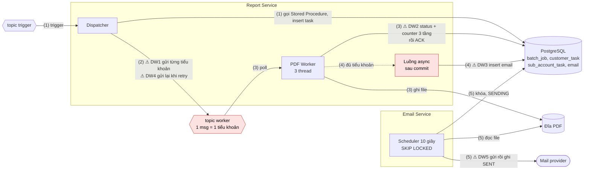
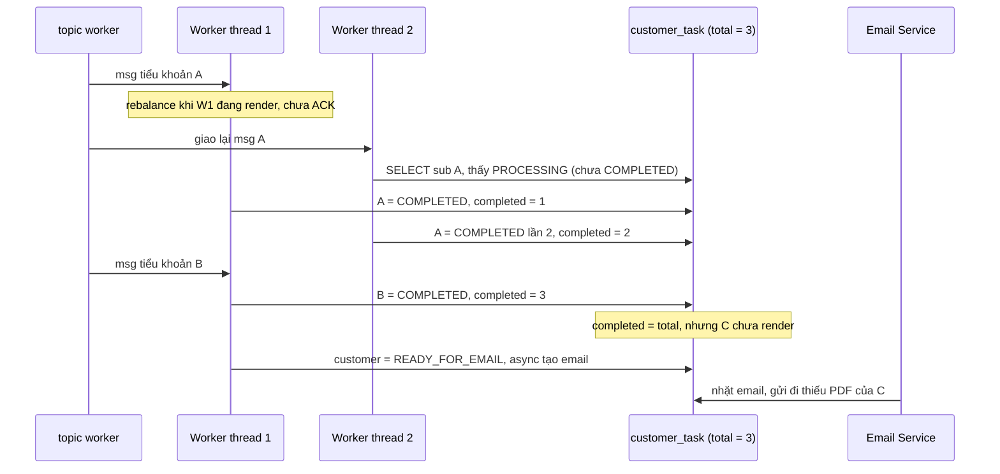
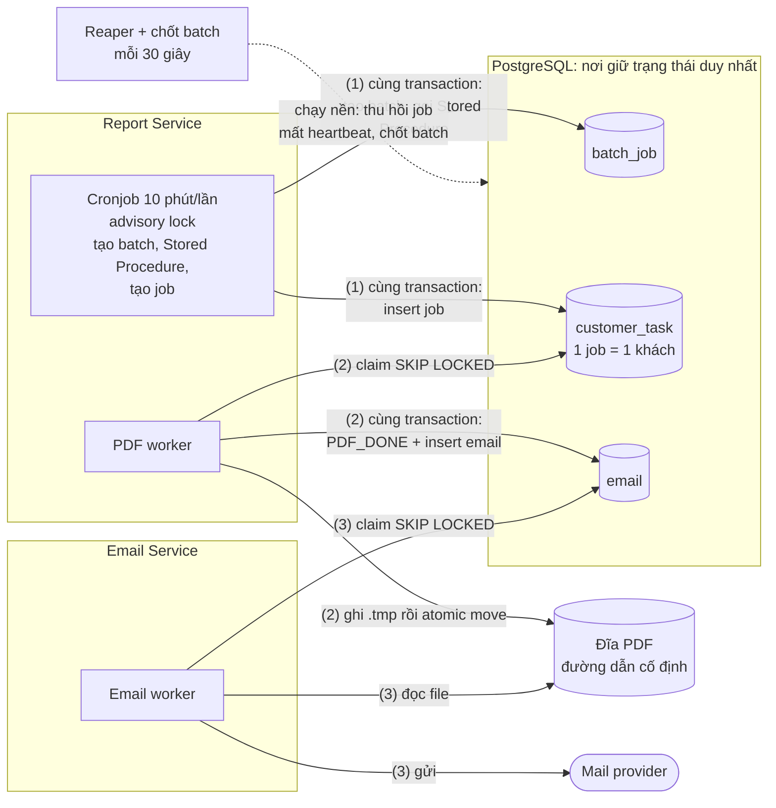

# Độc giả hỏi: luồng sao kê cuối ngày quản lý trạng thái và retry rối, thiết kế lại thế nào?

*Câu hỏi này đến từ một Người đăng ký của [Backend Internal](https://zemit.substack.com/p/backend-internal-kien-thuc-phong) qua mục Hỏi - Đáp 1:1, đã được ẩn danh và chia sẻ lại khi bạn đọc đồng ý. Bối cảnh: luồng sao kê cuối ngày (EOD) viết bằng Spring Boot, PostgreSQL, Kafka và JasperReports.*

Tóm tắt trong ba ý:

- **Bài toán:** Luồng sao kê tạo PDF cho từng tiểu khoản qua Kafka, rồi cộng counter qua 3 tầng bảng để biết khách nào đủ file mà gửi email.
- **Lỗi gốc:** Có 5 chỗ ghi kép (dual write): một bước ghi nối tiếp vào database, Kafka, file hoặc mail provider mà không có transaction chung, nên crash ở giữa thì các nơi lưu lệch trạng thái nhau.
- **Cách sửa:** Database làm nơi giữ trạng thái duy nhất, mỗi job lo trọn một khách, và PDF sinh lại được nên mọi bước trước email đều chạy lại an toàn.

---

## 1. Bài toán

- **Nghiệp vụ:** Cuối ngày có một trigger chạy sao kê theo ngày giao dịch. Một batch có nhiều khách hàng, mỗi khách có nhiều tiểu khoản, mỗi tiểu khoản render ra 1 file PDF.
- **Gửi email:** Khách nào đủ 100% PDF thì nhận 1 email đính kèm các file đó (tối đa 3 file). Mỗi khách thuộc một member, và email gửi qua mail provider riêng của member đó.
- **Khi lỗi:** Một tiểu khoản lỗi thì khách đó FAILED và không nhận email, các khách khác vẫn nhận bình thường.
- **Report Service:** Nhận trigger, gọi Stored Procedure, gửi từng tiểu khoản vào Kafka, render PDF, rồi tạo bản ghi email cho khách đã đủ PDF.
- **Email Service:** Cứ 10 giây poll PostgreSQL một lần, lấy email chưa gửi bằng `SKIP LOCKED`, gửi đi và cập nhật trạng thái.

Ba vấn đề bạn đọc đang gặp:

- **Counter lệch:** Worker chạy đa luồng cộng trừ counter ở 3 bảng, và counter lệch khi retry hoặc khi Kafka giao trùng message.
- **Treo trạng thái:** Batch treo ở PROCESSING_PDF khi app crash giữa lúc dispatch hoặc worker kẹt PROCESSING. Chặng email treo ở READY_FOR_EMAIL hoặc SENDING.
- **Thiếu cơ chế bảo vệ:** Chưa có watchdog quét task kẹt, chưa giới hạn số lần retry, chưa có DLT (dead letter topic, nơi chứa message đã hết lượt thử), email lỗi chưa có đường retry.

---

## 2. Thiết kế hiện tại

Luồng đi theo năm bước, đánh số (1) tới (5) trên sơ đồ:

1. **Khởi tạo:** Report Service nhận trigger, gọi Stored Procedure, rồi insert task cho từng khách và tiểu khoản.
2. **Dispatch:** Report Service gửi mỗi tiểu khoản thành một message vào topic worker.
3. **Render:** PDF Worker (3 thread, `max.poll.records=1`) nhận từng message, render PDF, cập nhật status tiểu khoản và cộng counter lên khách và batch, rồi ACK.
4. **Fan-in:** Khi `completed + failed >= total` và `failed = 0`, khách chuyển READY_FOR_EMAIL, và một luồng async chạy sau commit tạo bản ghi email.
5. **Gửi email:** Email Service nhặt email, gửi, rồi ghi SENT hoặc FAILED.

Các mũi tên đánh dấu `⚠ DWn` là 5 chỗ ghi kép (dual write).



---

## 3. Lỗi nằm ở đâu

Mỗi chỗ ghi kép là một khoảng hở: bước trước đã ghi xong, bước sau chưa kịp ghi thì app crash, và hai nơi lưu trạng thái lệch nhau. Ngoài 5 chỗ ghi kép, chặng email còn 2 lỗi ở đường retry (hai dòng cuối bảng).

| Điểm | Đứt giữa chừng thì |
|---|---|
| DW1 Dispatch | Crash giữa vòng gửi thì task PENDING không có message, retry chỉ tìm task FAILED nên không ai nhặt, batch treo PROCESSING_PDF |
| DW2 PDF Worker | Lỗi DB khi ghi FAILED vẫn đi tới ACK trong `finally`, task kẹt PROCESSING. Message giao lại lúc worker cũ chưa xong thì counter cộng hai lần |
| DW3 Luồng async tạo email | Crash ngay sau commit thì khách kẹt READY_FOR_EMAIL với `email_id = NULL`, Email Service không bao giờ nhặt |
| DW4 Retry | Gửi lại Kafka lỗi thì task PENDING không có message. Batch FAILED từ lúc chạy Stored Procedure chưa có task FAILED nào nên retry không làm gì |
| DW5 Gửi email | Crash giữa chừng thì email kẹt SENDING, vì chưa có watchdog thu hồi |
| Email lỗi | Khách FAILED do email nhưng mọi tiểu khoản đã COMPLETED, retry PDF không nhặt, còn retry email chưa có |
| Email Service chỉ nhìn ngày mới nhất | Retry bù batch của ngày cũ thì email của ngày cũ không được gửi |

Trong các lỗi này, ca dễ thấy hậu quả nhất là khách nhận email thiếu file. Code đã có bước kiểm tra `if (sub == COMPLETED) return`, nhưng bước này đọc bằng `SELECT` thường, nên không chặn được hai worker cùng xử lý một message song song, ví dụ khi rebalance (Kafka chia lại partition giữa các consumer):



W2 đọc lúc W1 chưa commit nên vẫn thấy A chưa xong, và cả hai cùng cộng counter. Phép `+1` không idempotent, nên khách đạt `total` khi tiểu khoản C còn chưa render, và email đi với 2 file thay vì 3.

**Câu `UPDATE` chưa kèm điều kiện:** Các câu `UPDATE` ghi kết quả nhiều khả năng cũng chưa kèm điều kiện trạng thái. Bước kiểm tra và bước ghi nằm ở hai câu lệnh rời, nên giữa hai câu luôn có khoảng hở cho worker khác chen vào. Khi điều kiện nằm ngay trong câu `UPDATE`, database kiểm tra và ghi trong cùng một thao tác atomic:

```sql
-- Không điều kiện: message xử lý trùng thì cả hai lần đều ghi và đều cộng counter
UPDATE sub_account_task SET status = 'COMPLETED' WHERE id = :id;
UPDATE customer_task SET completed_sub_accounts = completed_sub_accounts + 1 WHERE id = :customer_id;

-- Có điều kiện: lần đầu cập nhật được 1 dòng, lần trùng cập nhật được 0 dòng
UPDATE sub_account_task SET status = 'COMPLETED'
WHERE id = :id AND status = 'PROCESSING';
-- chỉ cộng counter khi câu trên cập nhật được 1 dòng
```

Với câu có điều kiện, `UPDATE` của W2 phải chờ row lock của W1. W1 commit xong thì PostgreSQL đánh giá lại điều kiện trên bản mới nhất, thấy A đã `COMPLETED` nên W2 cập nhật được 0 dòng và không cộng counter. Câu đánh dấu `PROCESSING` lúc nhận message cũng cần điều kiện tương tự (`WHERE status = 'PENDING'`), nếu không W2 có thể đưa A từ `COMPLETED` về lại `PROCESSING`.

---

## 4. Vì sao thiết kế này rất hay gặp

Thiết kế này không xuất phát từ cẩu thả, mà từ hai lối nghĩ nghe hợp lý. Đây cũng là hai lối nghĩ mình gặp nhiều nhất ở các hệ thống batch.

### 4.1 Over-splitting: chia nhỏ tối đa để chạy song song tối đa

Lối nghĩ đầu tiên là "chia càng nhỏ thì càng nhiều việc chạy cùng lúc". Tuy nhiên số việc chạy cùng lúc do số worker quyết định, không do số đơn vị việc. Report Service có 3 thread thì chia theo khách hay theo tiểu khoản, tại mỗi thời điểm vẫn chỉ có đúng 3 file đang render.

Cái giá của chia nhỏ nằm ở bước gom lại. Nghiệp vụ tính theo khách (một tiểu khoản lỗi thì cả khách lỗi, mỗi khách một email), nên việc đã chia theo tiểu khoản phải gom về theo khách. Toàn bộ counter 3 tầng, câu `completed + failed >= total` và phép trừ ngược khi retry đều sinh ra từ bước gom này, trong khi mỗi khách chỉ có tối đa 3 tiểu khoản.

### 4.2 Kafka everywhere: đặt Kafka ở mọi chặng để scale

Lối nghĩ thứ hai là "đặt Kafka giữa các chặng thì chặng nào cũng scale được". Kafka chịu tải lớn với event ngắn và ghi nhận tiến độ bằng offset (vị trí consumer đã đọc tới).

Job render PDF thì cần trạng thái riêng cho từng job: đang chạy hay chưa, ai đang giữ, đã thử mấy lần. Offset chỉ là một con số cho cả partition nên không mang được các thông tin này, vì vậy trạng thái vẫn phải nằm trong database, và mỗi chặng thêm Kafka là thêm một chỗ ghi kép.

Cấu hình `max.poll.records=1` cùng `MANUAL_IMMEDIATE` là dấu hiệu thường gặp khi Kafka đang được dùng làm work queue. Hạn chế của cách dùng này nằm ở bài [Kafka đã có queue thật, và vẫn không nên dùng Kafka làm work queue](https://zemit.substack.com/p/kafka-a-co-queue-that-va-ban-van).

Thật ra lời giải đã nằm sẵn trong hệ thống: Email Service không đọc Kafka mà lấy việc từ PostgreSQL bằng `SKIP LOCKED`, và chặng email không có counter nào để lệch. Cách sửa chủ yếu mang cách làm này sang chặng PDF, rồi vá các chỗ còn hở ở chặng email.

---

## 5. Cách sửa: database giữ trạng thái, PDF sinh lại được

Crash có thể rơi đúng vào khoảng giữa lúc "làm" (ghi file, gửi mail) và lúc "ghi nhận đã làm" (cập nhật database). Khi chạy lại, hệ thống không biết bước đó đã làm hay chưa, nên chỉ còn cách làm lại. Vì vậy thiết kế mới dựa trên ba nguyên tắc:

- **Database là nơi giữ trạng thái duy nhất:** Trạng thái của mọi job nằm trong PostgreSQL. Job nào chưa ghi nhận xong trong database thì coi như chưa làm, bất kể message hay file đang ở đâu.
- **Làm trước, ghi nhận sau:** Worker render file trước, sau đó mới ghi nhận bằng một câu `UPDATE` có điều kiện. Câu `UPDATE` cập nhật được 0 dòng nghĩa là job đã sang tay worker khác, và kết quả lần này bị bỏ.
- **PDF sinh lại được:** File ghi ra `.tmp` rồi atomic move sang đường dẫn cố định, nên render lại chỉ ghi đè đúng file cũ và Email Service không đọc phải file ghi dở. Vì vậy mọi bước trước khi gửi email đều chạy lại an toàn.

Luồng mới còn ba bước, đánh số (1) tới (3) trên sơ đồ:

1. **Trigger và batch:** Cronjob chạy 10 phút một lần, có lock, trong một transaction tạo `batch_job` cho ngày cần chạy sao kê, gọi Stored Procedure và tạo job cho từng khách.
2. **Render PDF:** PDF worker nhận job, ghi file, rồi chốt `PDF_DONE` và tạo email trong cùng transaction.
3. **Gửi email:** Email worker nhận email, đọc file và gửi qua mail provider.

Reaper chạy nền mỗi 30 giây, thu hồi job mất heartbeat và chốt batch.



### 5.1 Trigger và batch: cronjob có lock thay cho topic trigger

Thiết kế mới thay topic trigger bằng một cronjob trong Report Service, chạy 10 phút một lần. Mỗi lượt, cronjob làm hết trong một transaction: xem ngày giao dịch cần chạy sao kê đã có batch chưa, chưa có thì tạo batch, gọi Stored Procedure, tạo toàn bộ job của ngày bằng một câu `INSERT ... SELECT`, rồi chuyển batch sang `PROCESSING`.

**Về Stored Procedure:** Mình không khuyến khích đặt logic nghiệp vụ trong Stored Procedure, vì logic nằm trong database thì khó test, khó review và không deploy cùng code ứng dụng. Tuy nhiên hệ thống này đang vận hành bằng Stored Procedure, nên thiết kế mới giữ nguyên phần tính số liệu đó và chỉ sửa phần điều phối xung quanh.

Report Service chạy nhiều instance thì instance nào cũng chạy cronjob, nên câu đầu tiên của transaction là `pg_try_advisory_xact_lock`. Instance lấy được lock thì chạy, các instance khác nhận `false` và bỏ qua lượt này. Lock dạng `xact` tự nhả khi transaction kết thúc, nên dùng qua connection pool vẫn an toàn. Cách advisory lock hoạt động và bẫy khi đi qua connection pool nằm ở bài [Bốn cách triển khai pessimistic lock: lock sống ở đâu, ai nhả khi process chết](https://zemitprivate.substack.com/p/bon-cach-trien-khai-pessimistic-lock) (dành cho hội viên trả phí).

Crash hoặc Stored Procedure lỗi giữa chừng thì transaction rollback cả cụm: không có batch, không có job mồ côi, và lượt chạy 10 phút sau tự làm lại từ đầu. Batch chỉ xuất hiện khi đã đủ job, nên bỏ được cột `total_customers`, và bảng `batch_job` không cần claim, heartbeat hay reaper riêng. Ràng buộc `UNIQUE (trade_date)` giữ vai lưới an toàn phía sau lock.

Stored Procedure lỗi do dữ liệu thì lượt nào cũng lỗi, nên cần cảnh báo khi tới giờ mà ngày đó vẫn chưa có batch. Trường hợp Stored Procedure tự commit bên trong thì không nằm chung transaction được. Khi đó Stored Procedure phải chạy lại được cho cùng một ngày (xóa số cũ rồi tính lại), và cronjob chạy xong bước tính số liệu mới mở transaction tạo batch và job.

Nếu trigger bắt buộc phải đến từ hệ thống khác qua Kafka, phía Kafka chỉ cần ghi một dòng yêu cầu chạy vào `batch_job` (trạng thái `PENDING`, `ON CONFLICT (trade_date) DO NOTHING`), và cronjob nhận dòng `PENDING` này thay vì tự xét ngày cần chạy. Có hai cách ghi dòng này mà không tạo ghi kép:

- **Consumer nhỏ:** Consumer chỉ chạy câu `INSERT ... ON CONFLICT`, commit rồi mới ACK. Crash trước khi ACK thì Kafka giao lại message và `ON CONFLICT` bỏ qua lần ghi thứ hai.
- **Kafka Connect:** Nếu team đã vận hành sẵn cụm Kafka Connect thì JDBC sink connector ở chế độ upsert làm được việc này mà không cần viết code, miễn record chỉ mang khóa `trade_date` để connector sinh `ON CONFLICT DO NOTHING` (các cột khác lấy giá trị mặc định). Cách sink connector ghi từ topic xuống database nằm ở bài [CDC và Kafka Connect từ bên trong: từ binlog lên topic, từ topic về database](https://zemitprivate.substack.com/p/cdc-va-kafka-connect-tu-ben-trong) (dành cho hội viên trả phí).

### 5.2 PDF job: một job cho một khách hàng

Đơn vị thành công của nghiệp vụ là khách hàng, nên đơn vị job cũng là khách hàng. Một job render đủ các tiểu khoản của một khách rồi ghi kết quả một lần. Bước gom theo khách lúc đó chỉ là chờ đủ file trong bộ nhớ của worker, nên topic worker và toàn bộ counter đều bỏ được, và `sub_account_task` thôi tham gia điều phối.

Bảng `customer_task` dùng bộ cột của bảng jobs trong bài [Từ sync sang async: bản thiết kế cho import, export và mọi tác vụ chạy lâu](https://zemitprivate.substack.com/p/tu-sync-sang-async-blueprint-cho) (dành cho hội viên trả phí): `locked_by` (token sinh mới mỗi lần claim), `attempts`, `heartbeat_at` (lần cuối worker báo còn sống), `next_run_at`. Worker claim job bằng `SKIP LOCKED` trong một transaction ngắn, render chạy ngoài transaction:

```sql
WITH next_job AS (
    SELECT id
    FROM customer_task
    WHERE status = 'PENDING'
      AND next_run_at <= now()
    ORDER BY created_at
    LIMIT 1
    FOR UPDATE SKIP LOCKED
)
UPDATE customer_task t
SET status = 'PROCESSING',
    locked_by = :token,
    attempts = t.attempts + 1,
    heartbeat_at = now()
FROM next_job
WHERE t.id = next_job.id
RETURNING t.id, t.batch_id, t.customer_id, t.member_code, t.attempts;
```

Render đủ file thì worker ghi nhận và tạo email trong cùng một transaction, nên không còn khách kẹt READY_FOR_EMAIL với `email_id = NULL`:

```sql
BEGIN;

UPDATE customer_task
SET status = 'PDF_DONE', locked_by = NULL, finished_at = now()
WHERE id = :id AND status = 'PROCESSING' AND locked_by = :token;
-- 0 dòng: job đã sang tay lần claim khác, ROLLBACK và bỏ kết quả lần này

INSERT INTO email (customer_task_id, batch_id, member_code, attachments, status, attempts, next_run_at)
VALUES (:id, :batch_id, :member_code, :file_paths, 'NOT_SENT', 0, now())
ON CONFLICT (customer_task_id) DO NOTHING;

COMMIT;
```

Điều kiện `locked_by = :token` chặn đúng ca hai worker cùng xử lý một job như trong sơ đồ email thiếu file. Worker cũ ngừng heartbeat quá lâu (treo hoặc mất kết nối database) thì bị thu hồi job, worker khác claim lại với token mới, nên lúc worker cũ ghi nhận thì câu `UPDATE` cập nhật được 0 dòng và kết quả bị bỏ.

Nguyên lý này giống nhả Redis lock: trước khi xóa lock phải kiểm tra người giữ, nếu không thì xóa nhầm lock của người khác. Phần lock column, Redis lock có TTL và `SKIP LOCKED` cho hàng đợi job nằm ở bài [Bốn cách triển khai pessimistic lock: lock sống ở đâu, ai nhả khi process chết](https://zemitprivate.substack.com/p/bon-cach-trien-khai-pessimistic-lock) (dành cho hội viên trả phí).

Render lỗi thì job về `PENDING` kèm backoff (đặt `next_run_at` lùi về sau) nếu còn lượt, hết lượt thì `FAILED`. Một tiểu khoản lỗi làm cả job lỗi, đúng luật nghiệp vụ. Render lại cả khách chỉ tốn thêm tối đa 2 file.

### 5.3 Watchdog: heartbeat và reaper

Trong lúc render, một thread phụ cập nhật `heartbeat_at` mỗi 30 giây. Một tác vụ định kỳ (reaper) đóng vai watchdog đang thiếu, thu hồi job có heartbeat cũ hơn 90 giây:

```sql
UPDATE customer_task
SET status = CASE WHEN attempts < :max_attempts THEN 'PENDING' ELSE 'FAILED' END,
    last_error = CASE WHEN attempts >= :max_attempts
                      THEN 'Worker mất liên lạc, đã hết lượt thử lại' ELSE last_error END,
    locked_by = NULL,
    next_run_at = now()
WHERE status = 'PROCESSING'
  AND heartbeat_at < now() - INTERVAL '90 seconds';
```

Reaper chạy câu tương tự cho `email` kẹt `SENDING`, rồi chốt batch sang `COMPLETE` hoặc `FAILED` khi không còn job hay email nào chưa tới trạng thái cuối, kiểm tra bằng `NOT EXISTS` thay cho counter.

Dòng `FAILED` hết lượt đóng vai dead letter: job nằm lại trong database kèm `last_error`, nên không cần topic DLT riêng. Retry tay chỉ đổi các dòng `customer_task` và `email` đang `FAILED` về trạng thái chờ chạy và đặt lại `attempts`, rồi đưa batch `FAILED` về `PROCESSING` để reaper chốt lại. Retry tay không cộng trừ counter nào và không chạy lại Stored Procedure, nên bấm hai lần hay bấm khi batch đang chạy đều an toàn.

### 5.4 Khách lớn: render song song trong job và worker ưu tiên

Một vài khách có rất nhiều giao dịch trong ngày thì file sao kê dài và render lâu hơn hẳn. Với các khách này, worker render các tiểu khoản song song ngay trong job, rồi vẫn ghi nhận một lần.

Để khách lớn không chiếm hết worker của khách nhỏ, Report Service dành riêng một worker ưu tiên nhận job khách lớn. Lúc không có job khách lớn, worker này nhận job khách nhỏ, còn các worker khác chạy như bình thường.

### 5.5 Email Service: heartbeat, retry và claim trên mọi ngày

Chặng email giữ nguyên cách lấy việc bằng `SKIP LOCKED`. Ngoài phần tạo email cùng transaction với `PDF_DONE`, còn ba chỗ cần sửa:

- **Heartbeat cho `SENDING`:** Claim email ghi `locked_by`, `heartbeat_at`, tăng `attempts`, và reaper thu hồi email kẹt `SENDING`.
- **Retry có giới hạn:** Lỗi tạm thời của provider (timeout, bị giới hạn tốc độ) trả email về `NOT_SENT` kèm backoff. Lỗi vĩnh viễn hoặc hết lượt thì `FAILED`.
- **Claim trên mọi ngày:** Câu claim lọc theo `status` và `next_run_at` thay vì chỉ ngày mới nhất, nên email của batch ngày cũ retry bù vẫn được gửi.

Gửi mail là bước duy nhất không chạy lại được an toàn, vì mail provider không nhận ra hai lần gửi là một. Email Service crash sau khi provider đã nhận mail nhưng trước khi ghi `SENT` thì reaper trả email về `NOT_SENT` và khách nhận 2 email. Email Service ghi `SENT` ngay sau từng email để thu hẹp khoảng hở này.

Chặng email vì vậy gửi theo kiểu at-least-once (mỗi email tới khách ít nhất một lần), và với sao kê thì gửi trùng trong ca hiếm này dễ chấp nhận hơn mất mail.

### 5.6 Đối chiếu lỗi cũ với cách sửa

| Lỗi trong thiết kế cũ | Cách sửa |
|---|---|
| Counter lệch, email thiếu file do message trùng | Bỏ counter và topic worker. Job theo khách, ghi nhận kiểm tra `locked_by` |
| Task kẹt PENDING hoặc PROCESSING (dispatch crash, worker chết, ACK sau lỗi DB) | Job nằm trong database. Heartbeat quá hạn thì reaper trả job về `PENDING` |
| Batch treo vì `total_customers`, batch FAILED lúc chạy Stored Procedure không retry được | Cronjob có lock tạo batch, gọi Stored Procedure và tạo job trong một transaction. Lỗi thì rollback, lượt chạy sau tự làm lại |
| Khách kẹt READY_FOR_EMAIL thiếu `email_id` | Email insert cùng transaction với `PDF_DONE` |
| Email kẹt SENDING, email lỗi không retry, ngày cũ không được gửi | Heartbeat, `attempts`, `next_run_at` cho bảng email, claim trên mọi ngày |
| Thiếu giới hạn retry và DLT | `max_attempts`. Dòng `FAILED` đóng vai dead letter, retry tay đổi về trạng thái chờ chạy |

---

Bài này bắt đầu từ một tin nhắn mô tả hệ thống của bạn đọc. Mình vẽ lại luồng, chỉ ra chỗ hở rồi cùng bạn đọc trao đổi tới khi ra thiết kế mới. Nếu bạn cũng đang vướng một bài toán production tương tự, Người đăng ký [Backend Internal](https://zemit.substack.com/p/backend-internal-kien-thuc-phong) có thể gửi câu hỏi trực tiếp qua mục Hỏi - Đáp 1:1 nhé.
