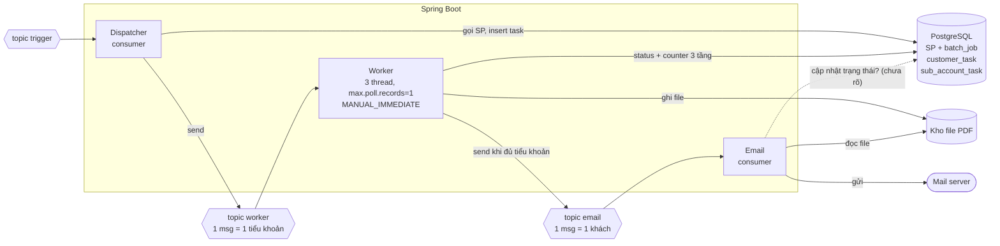
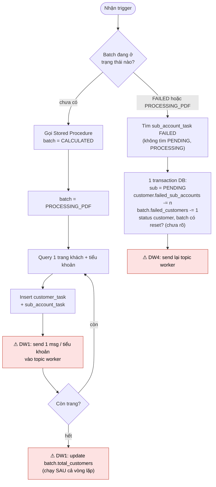
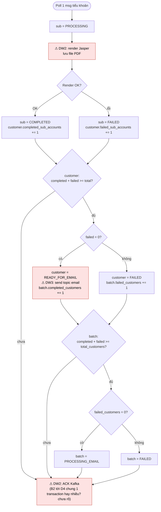
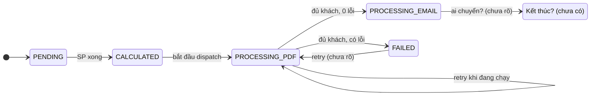
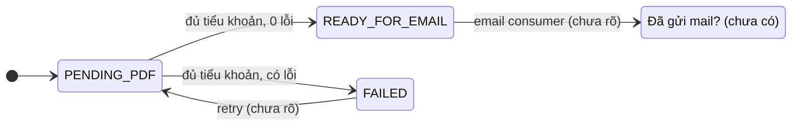
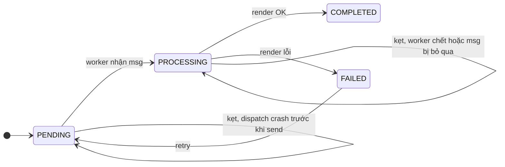
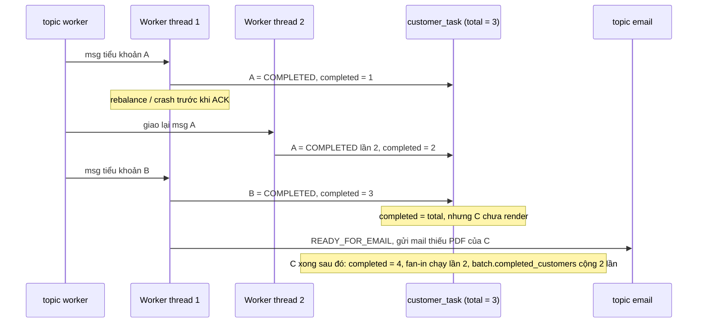

# Độc giả hỏi: luồng sao kê cuối ngày quản lý trạng thái và retry rối, thiết kế lại thế nào?

*Câu hỏi của bạn đọc, 2026-11-26. Bối cảnh: luồng sao kê cuối ngày (EOD) viết bằng Spring Boot, PostgreSQL, Kafka và JasperReports. Bản này là sơ đồ dựng lại từ mô tả của bạn đọc.*

Ký hiệu dùng trong bài:

- **`⚠ DWn`:** Điểm ghi kép (dual write), một bước ghi vào từ 2 hệ thống trở lên mà không có transaction chung.
- **"(chưa rõ)":** Chỗ mô tả của bạn đọc chưa nói tới, cần hỏi lại.

---

## 1. Bài toán

- **Nghiệp vụ:** Cuối ngày có một trigger chạy sao kê theo ngày giao dịch. Quan hệ 3 tầng: 1 Batch Job có nhiều khách hàng, mỗi khách hàng có nhiều tiểu khoản. Mỗi tiểu khoản render ra 1 file PDF.
- **Gửi email:** Khách hàng nào tạo xong 100% PDF thì gửi 1 email đính kèm tất cả file cho khách đó.
- **Khi lỗi:** Một tiểu khoản lỗi thì khách đó FAILED, không gửi email cho khách này. Các khách khác vẫn gửi bình thường.
- **Bảng `batch_job`:** Status PENDING → CALCULATED → PROCESSING_PDF → PROCESSING_EMAIL hoặc FAILED, kèm `total_customers`, `completed_customers`, `failed_customers`.
- **Bảng `customer_task`:** Status PENDING_PDF → READY_FOR_EMAIL hoặc FAILED, kèm `total_sub_accounts`, `completed_sub_accounts`, `failed_sub_accounts`.
- **Bảng `sub_account_task`:** Status PENDING → PROCESSING → COMPLETED hoặc FAILED.
- **Worker:** Kafka consumer 3 thread, `MANUAL_IMMEDIATE` ack, `max.poll.records=1`.

Ba vấn đề bạn đọc đang gặp:

- **Counter lệch:** Worker cộng trừ counter 2 chiều qua 3 bảng dưới đa luồng, dễ lệch khi retry hoặc khi Kafka giao trùng message.
- **Treo ở PROCESSING_PDF:** App crash giữa lúc dispatch để lại task PENDING, worker chết hoặc mất message để lại task PROCESSING, DB chập chờn đúng lúc ACK.
- **Thiếu cơ chế bảo vệ:** Chưa có watchdog quét task kẹt quá hạn, chưa giới hạn số lần retry, chưa có DLT.

---

## 2. Kiến trúc tổng thể

Số hệ thống mỗi thành phần phải ghi trong một lần xử lý:

- **Dispatcher:** PostgreSQL và Kafka.
- **Worker:** Kho file, PostgreSQL (3 bảng), Kafka topic email và Kafka ACK.
- **Email consumer:** Kho file, mail server và Kafka ACK, cộng PostgreSQL nếu có cập nhật trạng thái.

---

## 3. Luồng xử lý theo từng bước

### 3.1 Bước 1 (Dispatch) và Bước 4 (Retry)

### 3.2 Bước 2 (Worker) và Bước 3 (Fan-in 2 tầng)

---

## 4. Máy trạng thái của 3 bảng

Batch job:

Customer task:

Sub-account task:

---

## 5. Bản đồ ghi kép

Luồng này không dùng distributed transaction thật (2PC). Thay vào đó là 5 chỗ ghi kép, mỗi chỗ ghi nhiều hệ thống nối tiếp nhau, đứt ở giữa là lệch trạng thái.

| Điểm | Ghi vào | Đứt giữa chừng thì |
|---|---|---|
| DW1 Dispatch | DB insert task, Kafka send, DB update `total_customers` | Crash giữa vòng: task PENDING không có msg, retry chỉ tìm FAILED nên không ai nhặt. `total_customers` chưa set: fan-in batch so với 0 (chốt sớm) hoặc NULL (không bao giờ chốt) |
| DW2 Worker | File PDF, DB status và counter 3 tầng, Kafka ACK | Commit DB xong chưa ACK: msg giao lại, counter cộng thêm lần nữa. DB lỗi: error handler retry vài lần rồi bỏ qua msg, sub kẹt PROCESSING |
| DW3 Fan-in khách | DB status và counter batch, Kafka send email | DB commit rồi send lỗi: READY_FOR_EMAIL nhưng không có mail. Send rồi DB rollback: mail đi, status cũ, lần sau gửi nữa |
| DW4 Retry | DB reset và trừ counter, Kafka send | Send lỗi: sub PENDING không có msg. Msg cũ còn trong topic: tiểu khoản chạy 2 lần, counter lệch |
| DW5 Email | Kafka, file, mail server, DB (chưa rõ) | Gửi mail xong crash trước ACK: khách nhận 2 email |

---

## 6. Một ca cụ thể: msg trùng làm email gửi đi thiếu file

Phép `+1` không idempotent nên một message giao lại là đủ làm customer đạt `total` sớm. Điều kiện `>=` còn cho fan-in chạy thêm lần nữa khi C xong, Batch đếm khách này 2 lần và có thể chốt trong lúc khách khác chưa xong.
